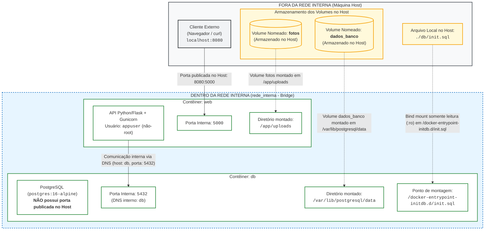

# Artefato A2 - Diagrama de Arquitetura

Este documento contém o **Diagrama de Arquitetura (Artefato A2)** da solução conteinerizada "Achados & Perdidos", representando as fronteiras de rede, contêineres, portas publicadas, volumes nomeados e pontos de montagem.

---

## Diagrama de Arquitetura do Ambiente

---

## Mapeamento dos Elementos Arquiteturais

| Categoria | Elemento | Descrição / Configuração |
| :--- | :--- | :--- |
| **Fronteira Externa** | Máquina Host | Ambiente hospedeiro onde rodam o cliente (`curl`/navegador) e o Docker Engine. |
| **Fronteira Externa** | Cliente HTTP | Acesso à API via `http://localhost:8080`. |
| **Fronteira Externa** | Script SQL Local | Arquivo `./db/init.sql` no Host contendo o schema DDL inicial. |
| **Fronteira Externa** | Armazenamento de Volumes | Áreas físicas no Host gerenciadas pelo Docker para persistência dos dados. |
| **Fronteira Interna** | `rede_interna` | Rede bridge definida pelo usuário (`driver: bridge`), provendo isolamento e resolução DNS automática. |
| **Porta Publicada** | `8080:5000` | Mapeamento que direciona o tráfego do Host (`:8080`) para a porta da aplicação (`:5000`). |
| **Contêiner Web** | `web` | API Python/Flask com Gunicorn escutando na porta 5000 sob o usuário não-privilegiado `appuser`. |
| **Contêiner DB** | `db` | Banco PostgreSQL (`postgres:16-alpine`) escutando na porta interna 5432 via DNS (`db`), **sem porta publicada no Host** (RNF03). |
| **Volume de Fotos** | `fotos` | Volume nomeado montado no contêiner `web` em `/app/uploads`. |
| **Volume de Banco** | `dados_banco` | Volume nomeado montado no contêiner `db` em `/var/lib/postgresql/data`. |
| **Bind Mount** | `./db/init.sql` | Arquivo do Host montado como somente leitura (`:ro`) em `/docker-entrypoint-initdb.d/init.sql` no contêiner `db`. |
