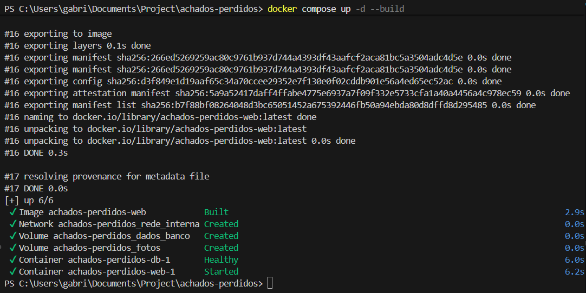
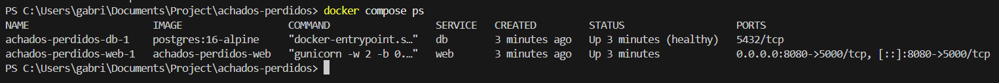
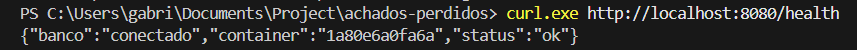
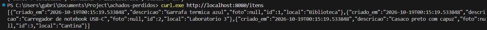
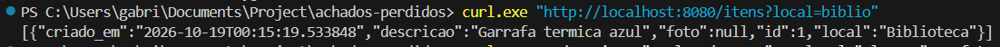
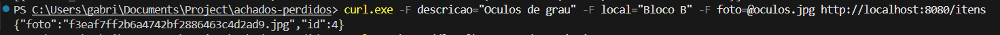
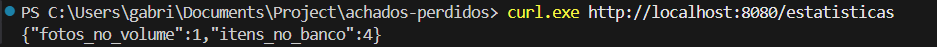
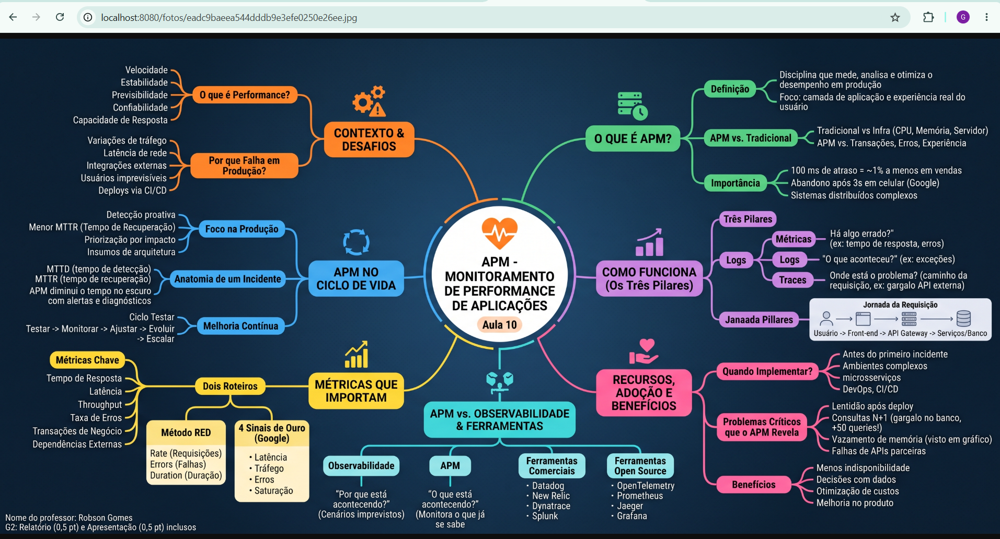
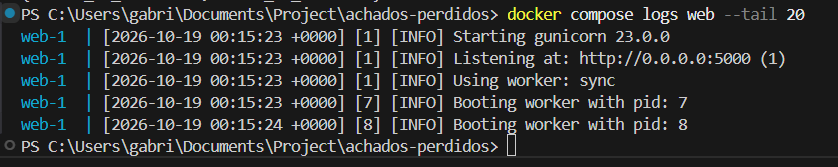

# Evidências de Teste - Tarefa 4

Este documento compila as comprovações de funcionamento da infraestrutura (Docker, banco de dados e aplicação web) seguindo rigorosamente o roteiro de testes do projeto, contendo legenda de uma linha em cada evidência conforme o Artefato A4.

### 1. Subida do Ambiente
**Objetivo:** Provar que todo o ambiente sobe com um único comando, sem erros.  
**Comando executado:** `docker compose up -d --build`  
  

### 2. Status dos Contêineres e Healthcheck
**Objetivo:** Mostrar que ambos os serviços estão rodando e que o banco de dados alcançou o status "healthy" exigido pelo RNF05.  
**Comando executado:** `docker compose ps`  
  

### 3. Teste de Saúde da API (RF01)
**Objetivo:** Verificar se a aplicação conectou com sucesso no banco de dados.  
**Comando executado:** `curl.exe http://localhost:8080/health`  
  

### 4. Listagem Geral de Itens (RF02)
**Objetivo:** Comprovar que o `bind mount` injetou o arquivo `init.sql` corretamente e populou o banco.  
**Comando executado:** `curl.exe http://localhost:8080/itens`  
  

### 5. Listagem com Filtro
**Objetivo:** Testar a busca por parâmetro na URL.  
**Comando executado:** `curl.exe "http://localhost:8080/itens?local=biblio"`  
  

### 6. Cadastro de Novo Item com Upload de Foto (RF03)
**Objetivo:** Testar a inserção no PostgreSQL e verificar se o contêiner web tem permissão (usuário restrito) para salvar o arquivo físico no volume de fotos.  
**Comando executado:** `curl.exe -F descricao="Oculos de grau" -F local="Bloco B" -F foto=@oculos.jpg http://localhost:8080/itens`  
  

### 7. Verificação de Estatísticas (RF04)
**Objetivo:** Validar a contagem de linhas no banco e a contagem de arquivos salvos fisicamente no volume.  
**Comando executado:** `curl.exe http://localhost:8080/estatisticas`  
  

### 8. Acesso à Foto no Navegador
**Objetivo:** Testar o acesso direto ao arquivo servido pelo Flask, validando a rota de leitura do volume.  
**Ação:** Acesso via navegador na URL da foto retornada no passo 6 (`http://localhost:8080/fotos/f3eaf7ff2b6a4742bf2886463c4d2ad9.jpg`).  
  

### 9. Leitura dos Logs do Contêiner
**Objetivo:** Mostrar as requisições chegando no servidor Gunicorn e comprovar o uso da porta 5000 internamente.  
**Comando executado:** `docker compose logs web --tail 20`  
  