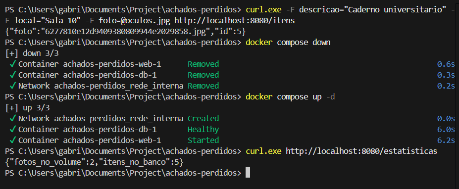
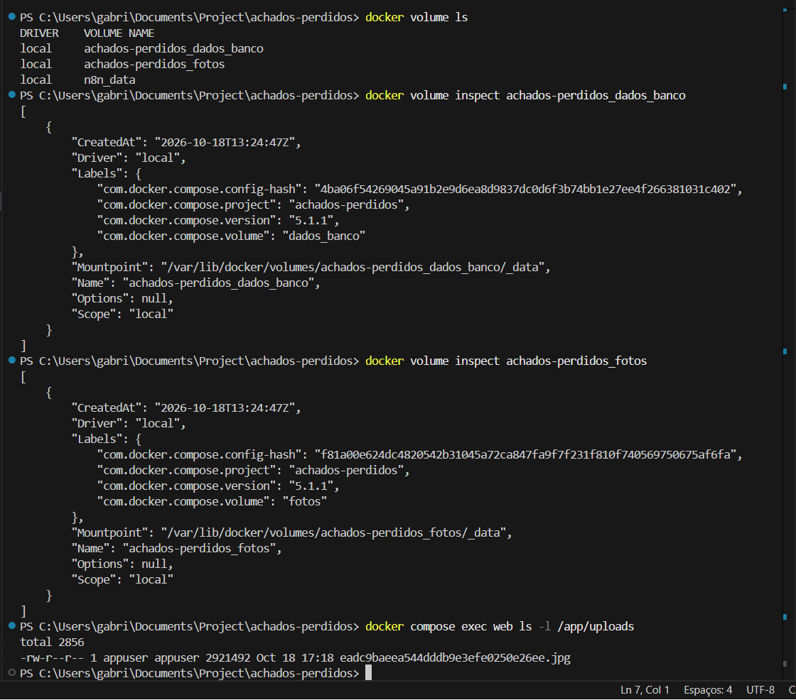
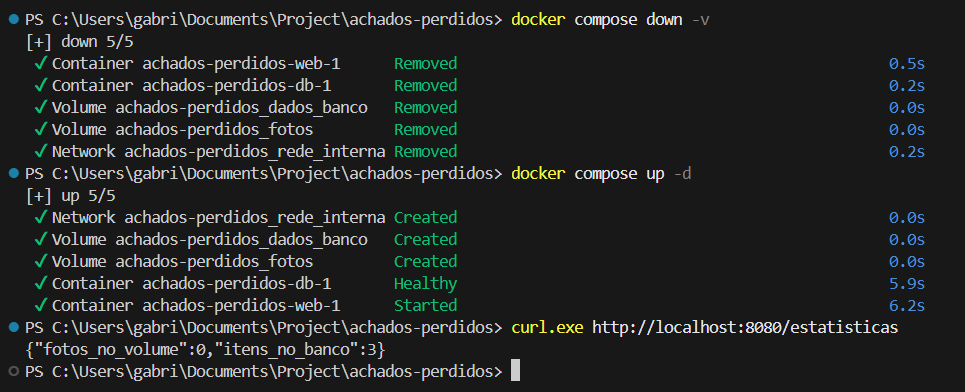

# Evidências de Teste - Tarefa 5 (Prova de Persistência)

Este documento reúne os testes de persistência de dados em volumes nomeados (`dados_banco` e `fotos`), respondendo pontualmente a todas as questões propostas no roteiro de testes e incluindo legendas de uma linha por evidência (Artefato A4).

---

### 1. Recriação dos Contêineres
**Pergunta do Roteiro:** Cadastre pelo menos dois objetos com foto. Execute `docker compose down` e depois `docker compose up -d`. Os itens e as fotos continuam lá?

**Resposta Técnica:**  
Sim, os itens cadastrados e as fotos enviadas continuam intactos. Ao executar `docker compose down`, apenas os contêineres e a rede virtual são desfeitos, enquanto os volumes nomeados (`dados_banco` e `fotos`) permanecem preservados no disco do host. Quando o comando `docker compose up -d` recria os contêineres, os volumes existentes são remontados imediatamente nos mesmos caminhos (`/var/lib/postgresql/data` e `/app/uploads`), mantendo o estado inalterado.

  

---

### 2. Inspeção dos Volumes
**Pergunta do Roteiro:** Execute `docker volume ls` e `docker volume inspect` nos dois volumes. Onde os dados ficam fisicamente? Liste o conteúdo do volume de fotos com `docker compose exec web ls -l /app/uploads`.

**Resposta Técnica:**  
Os dados residem fisicamente no sistema de arquivos do computador hospedeiro (Host), gerenciados de forma isolada pelo Docker Daemon. Ao inspecionar os volumes com `docker volume inspect`, o local exato no disco é informado pelo atributo `"Mountpoint"` (ex: `/var/lib/docker/volumes/achados-perdidos_dados_banco/_data` e `/var/lib/docker/volumes/achados-perdidos_fotos/_data`). O comando `exec` demonstra o arquivo físico salvo dentro da pasta `/app/uploads` com o usuário `appuser`.

  

---

### 3. Remoção dos Volumes
**Pergunta do Roteiro:** Execute `docker compose down -v` e suba novamente. O que aconteceu com os itens cadastrados, com as fotos e com os três itens de exemplo do init.sql? Explique por quê.

**Resposta Técnica:**  
Todos os itens e arquivos de fotos cadastrados manualmente foram definitivamente apagados, pois a flag `-v` (`--volumes`) instrui o Docker Compose a destruir também os volumes nomeados associados ao projeto. Contudo, os três itens de exemplo iniciais reapareceram na base de dados. Isso ocorre porque, quando o serviço PostgreSQL sobe apontando para um diretório de dados completamente vazio, o entrypoint oficial do PostgreSQL executa compulsoriamente os scripts SQL presentes no diretório `/docker-entrypoint-initdb.d/` (montado a partir do `db/init.sql`).

  
